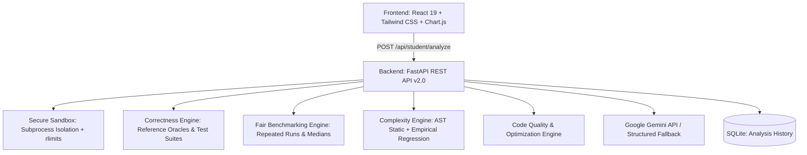

# 🎓 Student Algorithm Analyzer & Intelligent Comparison Platform
## Complete Redesign & Enhancement of Algorithm Heatmap Analyzer

[](https://fastapi.tiangolo.com/)
[](https://react.dev/)
[](https://tailwindcss.com/)
[](https://scikit-learn.org/)
[](https://ai.google.dev/)
[](https://www.sqlite.org/)
[](LICENSE)

A comprehensive academic analytics platform designed for students and educators in Design and Analysis of Algorithms (DAA). Students can submit custom algorithm source code developed by themselves in **Python, C, C++, Java, or JavaScript**, validate correctness against verified oracle references, benchmark performance under isolated sandbox limits against standard algorithms, fit empirical complexity curves, receive static AST evaluations, and get educational AI guidance.

---

## 🌟 Key Features

### 1. 🧑‍💻 Student Algorithm Analyzer (Primary Module)
- **Multi-Language Support**: Submit source code in **Python**, **C**, **C++**, **Java**, or **JavaScript (Node.js)**.
- **Embedded Code Editor**: Built-in dark code editor with syntax indentation, line numbers, template loaders, and status indicators.
- **Top Navigation Layout**: Streamlined, full-width top navigation bar with dark/light theme switching, live sandbox status, and responsive mobile menu.
- **8 Core Platform Modules**:
  1. **Dashboard**: High-level platform statistics, quick actions, and recent submission stream.
  2. **Analyze My Algorithm**: Multi-language student code submission, correctness validation, sandbox benchmarking, quality rubric, and AI reports.
  3. **Compare Algorithms**: Side-by-side synchronized comparison against standard reference algorithms with interactive metrics.
  4. **Performance Heatmap**: Multi-dimensional matrix visualizing execution time, memory, and operations across input scales and dataset topologies.
  5. **Complexity Analysis**: Empirical regression curve fitting across 8 Big-O classes alongside AST static structure analysis.
  6. **Code Optimization**: Automated bottleneck detection, algorithmic explanations, refactored code generation, and benchmark diffs.
  7. **Algorithm Visualizer**: Step-by-step visual execution of classical algorithms.
  8. **AI Study Companion**: Interactive pedagogical assistant grounded in actual empirical benchmark data.
- **Problem Categories**:
  - **Sorting**: Bubble, Selection, Insertion, Merge, Quick, Heap Sort
  - **Searching**: Linear Search, Binary Search
  - **Graph Algorithms**: BFS, DFS, Dijkstra's Shortest Path, Topological Sort (Kahn's)
  - **String Matching**: Naive String Match, KMP, Horspool, Boyer-Moore
  - **Dynamic Programming & Backtracking**: 0/1 Knapsack, N-Queens

### 2. 🛡️ Secure Isolated Sandbox
- **Process Isolation**: Subprocess runs with dedicated session and process groups (`os.setsid`), preventing arbitrary shell attacks and process escapes.
- **Resource Limits**: Strict CPU timeouts (`RLIMIT_CPU`), peak resident memory caps (`RLIMIT_AS`), file creation size limits (`RLIMIT_FSIZE`), and process forks (`RLIMIT_NPROC`).
- **Zero Network Access**: Strips all external network access and isolates temporary working filesystems.
- **Clean Environment**: Strips host secrets, API keys, and credentials before spawning student code.
- **Process Group Termination**: Kills child processes and all descendant threads cleanly on timeout or error.

### 3. ✅ Correctness Validation Engine
- Verifies submitted student logic against problem-specific trusted reference oracles.
- Rigorous test suite covering:
  - Normal input
  - Empty input (`[]` or `0`)
  - Single-element input
  - All duplicates / duplicate-heavy
  - Already sorted (best-case)
  - Reverse sorted (worst-case)
  - Random arrays
  - Negative numbers and boundary values
  - Moderate / large scale stress cases
- Distinguishes validated competitors from diagnostic failure runs.

### 4. ⚡ Fair Synchronized Benchmarking Engine
- Benchmarks student code and selected standard algorithms on **identical generated datasets**.
- Datasets: *Random*, *Sorted*, *Reverse Sorted*, *Nearly Sorted*, *Duplicate-Heavy*, *Edge Cases*.
- Dataset generation occurs **outside** the measured interval.
- Separates compilation time (C, C++, Java) from pure runtime.
- Multi-run warm-up executions with **median reporting and variance tracking**.

### 5. 📈 Dual Complexity Analysis (Theoretical + Empirical)
- **Theoretical AST Static Analysis**: Analyzes AST trees (Python) and lexical loop constructs (C/C++/Java/JS) to evaluate loop nesting depth, recursion branching factors, auxiliary space, and best/average/worst-case Big-O bounds.
- **Empirical Regression Modeling**: Fits measured runtimes against 8 standard candidate complexity classes:
  $$O(1), \quad O(\log n), \quad O(n), \quad O(n \log n), \quad O(n^2), \quad O(n^3), \quad O(2^n), \quad O(n!)$$
- Computes $R^2$ goodness-of-fit, model residuals, and extrapolations ($10^5$, $10^6$).

### 6. 🏆 Code Quality & Optimization Modules
- **5-Dimension Quality Rubric (100 pts)**:
  1. Readability & Structure (20 pts)
  2. Naming Conventions (20 pts)
  3. Algorithmic Efficiency & Loop Economy (20 pts)
  4. Memory & Resource Discipline (20 pts)
  5. Robustness & Edge-Case Safety (20 pts)
- **Interactive Code Optimization**: Identifies algorithmic bottlenecks, suggests fixes, generates refactored code safely, and runs side-by-side benchmark diffs.

### 7. 🤖 Gemini AI Educational Report (Sections A through K)
Generates structured academic evaluations based strictly on backend measurements:
- **A. Overall Summary**
- **B. Correctness Explanation**
- **C. Theoretical Complexity Explanation**
- **D. Empirical Complexity Explanation**
- **E. Performance Comparison**
- **F. Strengths of Student Implementation**
- **G. Weaknesses of Student Implementation**
- **H. Inefficient Code Sections**
- **I. Optimization Suggestions**
- **J. Comparison with Standard Algorithms**
- **K. Learning Recommendations**

### 8. 💾 Persistence & Analysis History
- Lightweight SQLite persistence layer (`analysis_history.db`).
- Review past submissions, benchmark curves, and correctness scores.
- One-click downloadable Markdown / PDF evaluation report.

---

## 🛠️ Architecture



---

## 🚀 Quick Start Guide

### Prerequisites
- **Python**: `3.10` or higher
- **Node.js**: `18.0` or higher (with `npm`)
- **C / C++ Compiler**: `clang` / `gcc` (pre-installed on macOS/Linux)
- **Java**: Optional JDK (`javac`/`java`)

---

### 1. Backend Setup

1. Open a terminal and navigate to the backend directory:
   ```bash
   cd backend
   ```

2. Run the server using Python:
   ```bash
   PYTHONPATH=. python3 -m uvicorn app.main:app --host 127.0.0.1 --port 8000 --reload
   ```

3. (Optional) Configure Gemini API key for live AI tutoring in `backend/.env`:
   ```bash
   GEMINI_API_KEY=your_actual_api_key_here
   ```

---

### 2. Frontend Setup

1. Open a second terminal and navigate to the frontend directory:
   ```bash
   cd frontend
   ```

2. Start the Vite development server:
   ```bash
   npm run dev
   ```

3. Open your browser at:
   ```
   http://localhost:3000
   ```

---

## 🧪 Running Automated Tests

Run the complete 17-point automated test suite:

```bash
cd backend
PYTHONPATH=. python3 -m unittest tests/test_student_analyzer.py
```

Tests cover:
- Multi-language execution (Python, C, C++, Java, JavaScript)
- Compilation and syntax errors
- Runtime exceptions and incorrect output detection
- Infinite loops, timeouts, and process group terminations
- Security sandbox policy enforcement
- Correctness edge cases (empty, duplicates, bounds)
- Static AST and empirical regression curve fitting
- End-to-end REST API lifecycle and SQLite persistence

---

## 📡 REST API Reference

| Endpoint | Method | Description |
| :--- | :--- | :--- |
| `/api/student/algorithms` | GET | Catalog of categories and standard algorithms |
| `/api/student/validate` | POST | Correctness verification across test cases |
| `/api/student/benchmark` | POST | Sandboxed benchmarking across input sizes |
| `/api/student/compare` | POST | Fair synchronized benchmark with standard algorithms |
| `/api/student/complexity` | POST | AST static analysis + empirical curve fitting |
| `/api/student/quality` | POST | Code quality rubric evaluation |
| `/api/student/optimize` | POST | Bottleneck identification & refactoring |
| `/api/student/analyze` | POST | Complete analysis lifecycle |
| `/api/student/history` | GET | Retrieves past student submissions |
| `/api/student/analysis/{id}` | GET | Fetches specific analysis details |
| `/api/student/report/{id}` | GET | Downloadable analysis evaluation report |

---

## 📜 License
Distributed under the MIT License.
