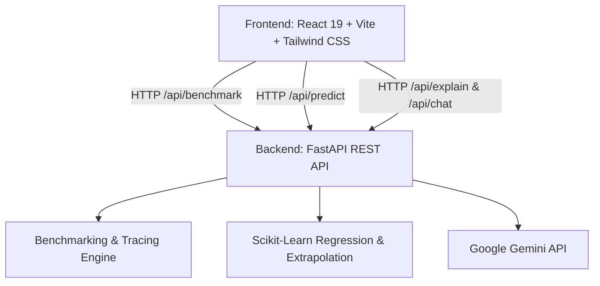

# 🔥 Algorithm Complexity Heatmap Analyzer

An interactive full-stack benchmarking, visualization, and AI-driven complexity analysis platform for Design and Analysis of Algorithms (DAA). Benchmark algorithms in real-time across custom input sizes and dataset distributions, generate visual performance heatmaps, predict asymptotic Big-O bounds with machine learning regression, and receive educational insights powered by Google Gemini.

---

## 🌟 Key Features

- **⚡ Real-Time Multi-Metric Benchmarking**:
  - Benchmark across execution time ($ms$), peak memory allocation ($bytes$), elementary operation counts, and maximum recursion depth.
  - Test under multiple dataset conditions: *Random*, *Sorted (Best Case)*, *Reverse Sorted (Worst Case)*, and *Nearly Sorted*.
- **🔥 Dynamic Complexity Heatmaps**:
  - Visualize execution bottlenecks across algorithm combinations and input scales ($N = 10$ to $100,000+$).
  - Highlighting performance gradients to instantly identify quadratic or exponential degradation.
- **🎬 Interactive Algorithm Visualizer**:
  - Step-by-step visual playback with speed control, step-through debugging, and state changes for sorting, searching, and graph traversals.
- **📈 ML-Powered Big-O Complexity Prediction**:
  - Uses curve-fitting regression models ($O(1)$, $O(\log n)$, $O(n)$, $O(n \log n)$, $O(n^2)$, $O(n^3)$, $O(2^n)$) to classify practical algorithmic complexity and extrapolate performance to massive scales ($10^5$, $10^6$).
- **⚖️ Side-by-Side Algorithm Comparison**:
  - Comparative analytics and synchronized Chart.js graphs for comparing execution time, memory footprints, and operation counts.
- **🤖 Gemini AI Algorithm Assistant & Explainer**:
  - In-depth theoretical breakdowns of empirical benchmark results compared against theoretical upper bounds.
  - Interactive DAA chat tutor to ask questions, optimize custom implementations, and compare algorithmic strategies.

---

## 🧮 Supported Algorithms

| Category | Algorithms |
| :--- | :--- |
| **Sorting** | Bubble Sort, Selection Sort, Insertion Sort, Merge Sort, Quick Sort, Heap Sort |
| **Searching** | Linear Search, Binary Search |
| **Graph** | Breadth-First Search (BFS), Depth-First Search (DFS), Dijkstra's Algorithm, Topological Sort |
| **String Matching** | Naive Pattern Matching, Knuth-Morris-Pratt (KMP), Horspool, Boyer-Moore |
| **Advanced / DP** | 0/1 Knapsack Problem, N-Queens Problem |

---

## 🛠️ Architecture & Tech Stack



- **Backend**:
  - **FastAPI**: Asynchronous, high-performance Python REST API framework.
  - **NumPy, Pandas, Scikit-learn**: Data manipulation, mathematical curve fitting, and asymptotic regression.
  - **Google GenAI SDK**: Multi-turn educational AI dialogues and benchmark report generation.
  - **psutil**: Process memory profiling and resource tracking.
- **Frontend**:
  - **React 19 & Vite**: Ultra-fast component rendering and hot module reloading.
  - **Tailwind CSS v4**: Modern, responsive styling with dark-mode aesthetic.
  - **Framer Motion**: Smooth page and component transitions.
  - **Chart.js & React-Chartjs-2**: Interactive multi-metric performance graphs.
  - **Lucide React**: Clean UI iconography.

---

## 🚀 Getting Started

### Prerequisites
- **Python**: `3.10` or higher
- **Node.js**: `18.0` or higher (with `npm`)
- **Google Gemini API Key**: Optional, required for AI analysis and chatbot features. Get one for free at [Google AI Studio](https://aistudio.google.com/).

---

### 1. Backend Setup

1. Open a terminal and navigate to the `backend` directory:
   ```bash
   cd backend
   ```

2. Create and activate a Python virtual environment:
   ```bash
   # On macOS / Linux:
   python3 -m venv venv
   source venv/bin/activate

   # On Windows:
   python -m venv venv
   venv\Scripts\activate
   ```

3. Install required Python packages:
   ```bash
   pip install -r requirements.txt
   ```

4. Configure environment variables:
   ```bash
   cp .env.example .env
   ```
   Edit `.env` to include your Gemini API key:
   ```env
   GEMINI_API_KEY=your_gemini_api_key_here
   PORT=8000
   HOST=127.0.0.1
   ```

5. Start the FastAPI backend server:
   ```bash
   uvicorn app.main:app --reload --host 127.0.0.1 --port 8000
   ```
   *The backend API documentation is available at `http://127.0.0.1:8000/docs`.*

---

### 2. Frontend Setup

1. Open a new terminal window and navigate to the `frontend` directory:
   ```bash
   cd frontend
   ```

2. Install Node dependencies:
   ```bash
   npm install
   ```

3. Start the Vite development server:
   ```bash
   npm run dev
   ```

4. Open your browser and navigate to:
   ```
   http://localhost:3000
   ```

---

## 📡 API Overview

| Endpoint | Method | Description |
| :--- | :--- | :--- |
| `/api/health` | `GET` | Health check to verify server status. |
| `/api/benchmark` | `POST` | Executes real-time benchmarks for selected algorithms, dataset type, and input sizes. |
| `/api/predict` | `POST` | Analyzes benchmark points and predicts Big-O complexity via curve-fitting regression. |
| `/api/recommend` | `POST` | Returns recommended algorithm based on input distribution and scale constraints. |
| `/api/explain` | `POST` | Generates a Gemini-powered performance analysis comparing empirical vs theoretical bounds. |
| `/api/chat` | `POST` | Multi-turn algorithmic tutor and code review assistant. |

---

## 🔒 Security & Environment Configuration

- **API Keys & Secrets**:
  - Never commit `.env` or files containing secret keys to Git.
  - The repository includes a `.gitignore` configured to ignore `.env`, virtual environments (`venv/`), Python cache (`__pycache__/`), and `node_modules/`.
  - Always use `backend/.env.example` as a template for new environments.
  - In the frontend, custom Gemini API keys can also be supplied per-session in the UI without exposing server credentials.

---

## 📂 Project Structure

```
algorithm-heatmap-analyzer/
├── backend/
│   ├── app/
│   │   ├── __init__.py
│   │   ├── ai_prediction.py       # ML regression models & asymptotic curve fitting
│   │   ├── algorithms.py          # Implementations & instrumentation of all algorithms
│   │   ├── benchmark.py           # Timing, memory profiling & counter harnesses
│   │   ├── gemini_service.py      # Google GenAI integration for reports & chat
│   │   └── main.py                # FastAPI endpoints & route validation
│   ├── .env.example               # Template environment configuration
│   └── requirements.txt           # Python dependencies
├── frontend/
│   ├── public/                    # Static assets & icons
│   ├── src/
│   │   ├── assets/                # Images & vector graphics
│   │   ├── pages/                 # Dashboard views (Benchmarking, Heatmap, Visualizer, etc.)
│   │   ├── services/              # API communication layer
│   │   ├── App.jsx                # Core router & navigation layout
│   │   ├── index.css              # Global styles & Tailwind configuration
│   │   └── main.jsx               # React entry point
│   ├── package.json               # Frontend dependencies & scripts
│   └── vite.config.js             # Vite configuration with backend proxy
├── .gitignore                     # Git ignore rules for root, backend, and frontend
└── README.md                      # Comprehensive project documentation
```

---

## 📜 License

This project is licensed under the MIT License.
